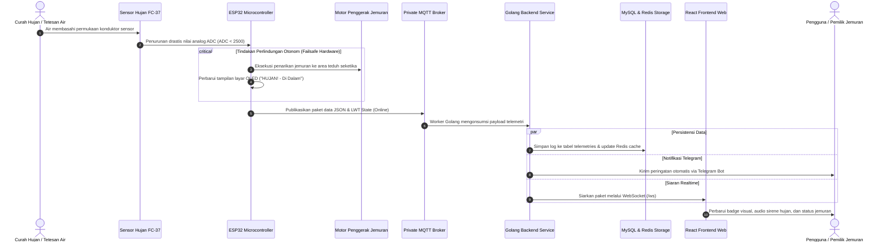

# HujanPantau - Sistem Pemantauan Sensor Hujan dan Jemuran Otomatis IoT

[](https://github.com/firdyridho/Project-IoT_Sensor-Jemuran-Otomatis/actions)
[](https://react.dev/)
[](https://www.typescriptlang.org/)
[](https://vitejs.dev/)
[](https://tailwindcss.com/)
[](https://go.dev/)
[](https://www.mysql.com/)
[](https://redis.io/)
[](https://mosquitto.org/)
[](https://vercel.com/)
[](LICENSE)

HujanPantau adalah platform Internet of Things (IoT) end-to-end terintegrasi yang dirancang untuk mendeteksi intensitas curah hujan secara realtime, menggerakkan motor pelindung jemuran secara otomatis, mengumpulkan telemetri mikroklimat ke database relasional dan in-memory cache, serta menyajikan visualisasi data interaktif yang disinkronkan dengan prakiraan cuaca resmi BMKG Indonesia.

---

## Daftar Lingkungan (Deployment Environments)

### 1. Web Frontend (Vercel)
* **Production**: [https://rintik-self.vercel.app/](https://rintik-self.vercel.app/) (Branch: `main`)
* **Staging / Preview**: Vercel Preview Deployments (Dikelola otomatis pada setiap push ke branch `staging`)

### 2. Backend Server & API Gateway (Tencent Cloud Lighthouse VPS)
Layanan backend Golang, database MySQL, in-memory cache Redis, dan private MQTT broker dioperasikan pada server cloud dengan spesifikasi produksi:
* **Host IP**: `43.133.136.149` (Wilayah Singapura, latensi jaringan < 15 ms)
* **Domain Reverse Proxy**: `https://staging-43-133-136-149.sslip.io`
* **Dokumentasi Teknis Infrastruktur**: [docs/DEPLOYMENT_GUIDE.md](docs/DEPLOYMENT_GUIDE.md)

---

## Arsitektur Sistem

Sistem menggunakan pola arsitektur modular terdistribusi (Decoupled Microservice & Event-Driven Architecture) untuk menjamin keandalan perangkat keras di lapangan dan latensi minimal pada antarmuka pengguna:

```mermaid
graph TD
    subgraph Hardware ["Hardware Lapangan (IoT Node)"]
        ESP32["ESP32 Microcontroller"]
        SensorHujan["Sensor Hujan FC-37 / MH-RD"]
        SensorLDR["Sensor Cahaya LDR"]
        MotorJemuran["Driver Motor Stepper / Servo"]
        OLEDDisplay["Layar OLED SSD1306 (128x64)"]

        SensorHujan -->|ADC Analog GPIO 33| ESP32
        SensorLDR -->|ADC Analog GPIO 34| ESP32
        ESP32 -->|Kontrol Sinyal Step/Dir| MotorJemuran
        ESP32 -->|I2C SDA/SCL| OLEDDisplay
    end

    subgraph Broker ["Private Cloud MQTT Broker"]
        PrivateMosquitto["Dedicated Mosquitto Broker (TCP 1883)<br/>Local Loopback (127.0.0.1)"]
    end

    subgraph VPS ["Lighthouse Cloud VPS (aaPanel Linux AMD64)"]
        subgraph BackendGo ["Golang Backend Service"]
            MQTTSub["MQTT Subscriber Daemon"]
            GinEngine["Gin REST API Engine"]
            WSHub["WebSocket Broadcast Hub"]
            AIEngine["AI Rain Prediction Engine"]
            TelegramBot["Telegram Bot Poller & Notifier"]
        end
        MySQL[("MySQL Database Storage")]
        RedisCache[("Redis In-Memory Cache")]
        NginxProxy["Nginx Reverse Proxy & SSL"]

        MQTTSub -->|Log Riwayat Telemetri| MySQL
        MQTTSub -->|Cache State Terkini| RedisCache
        MQTTSub -->|Event Telemetri & State| WSHub
        MQTTSub -->|Notifikasi Darurat| TelegramBot
        AIEngine -->|Prakiraan Curah Hujan| MySQL
        WSHub --> NginxProxy
        GinEngine --> NginxProxy
    end

    subgraph Client ["Client & Layanan Eksternal"]
        VercelCDN["Vercel Global Edge CDN"]
        WebDashboard["React 19 SPA Dashboard"]
        BMKGAPI["API Cuaca Terbuka BMKG Indonesia"]
        TelegramUser["Aplikasi Telegram Pengguna"]

        VercelCDN --> WebDashboard
        NginxProxy -->|WebSocket (/ws) & REST API| WebDashboard
        WebDashboard -->|Data Prakiraan ADM4| BMKGAPI
        TelegramBot --> TelegramUser
    end

    ESP32 -->|Publish Telemetry, State, & Data| PrivateMosquitto
    PrivateMosquitto -->|Subscribe Topics| MQTTSub
    GinEngine -->|Publish Kontrol Motor Manual| PrivateMosquitto
    PrivateMosquitto -->|Perintah Tarik/Dorong| ESP32
```

---

## Diagram Sekuensial Operasional

Alur kerja peristiwa saat mendeteksi air hujan dan eksekusi keselamatan perangkat:



---

## Fitur Utama

### 1. Deteksi Presisi dan Otonomi Perangkat Keras
* **Kalibrasi Nilai Analog**: Menggunakan pembacaan rentang ADC 0-4095 dengan kalkulasi histeresis untuk membedakan hujan riil dari embun pagi atau kelembapan tinggi.
* **Failsafe Independen**: Logika penarikan jemuran dieksekusi secara lokal di dalam mikrokontroler ESP32 tanpa memerlukan ketergantungan koneksi internet. Jika jaringan internet terputus, jemuran tetap aman dari air hujan.
* **Layar OLED Lokal**: Menampilkan status cuaca, intensitas sensor, dan status posisi jemuran secara langsung pada unit fisik lapangan.

### 2. Private MQTT Broker dan Jaringan Berlatensi Rendah
* **Dedicated Mosquitto Broker**: Berjalan pada server VPS privat (port 1883) tanpa interferensi perangkat dari luar atau batasan kuota broker publik gratis.
* **Latensi Minimal**: Terhubung langsung ke infrastruktur cloud regional Asia Pasifik dengan waktu tanggap koneksi sub-15 ms.
* **Mekanisme LWT (Last Will and Testament)**: Mendeteksi pemutusan daya perangkat secara otomatis melalui keepalive 5 detik.

### 3. Backend Kinerja Tinggi (Golang)
* **Arsitektur Konkuren Non-Blocking**: Menggunakan goroutines dan channels untuk menangani konsumsi pesan MQTT dan ribuan koneksi WebSocket secara simultan.
* **Penyimpanan Ganda (Hybrid Storage)**: MySQL 5.7 untuk integritas relasional riwayat jangka panjang, serta Redis untuk operasi lookup status mikrokontroler berkecepatan mikrodetik.
* **Mesin Analisis Cerdas (AI Prediction Engine)**: Menganalisis delta penurunan suhu, kenaikan kelembapan, dan tren sensor analog untuk memprediksi probabilitas hujan sebelum air menyentuh permukaan sensor.
* **Integrasi Bot Telegram**: Notifikasi darurat otomatis langsung ke ponsel pengguna ketika hujan terdeteksi atau jemuran berpindah posisi.

### 4. Antarmuka Web Modern (React 19 & Tailwind CSS v4)
* **Visualisasi Realtime**: Pembaruan grafik fluktuasi sensor analog secara langsung tanpa perlu memuat ulang peramban.
* **Sinkronisasi BMKG**: Mengambil data prakiraan cuaca resmi BMKG Indonesia berbasis kode kelurahan administratif (ADM4).
* **Dukungan Tema & Audio**: Mode Gelap, Mode Terang, mode audio peringatan hujan dinamis, serta tata letak responsif untuk perangkat mobile dan desktop.

### 5. Otomasi CI/CD Terintegrasi
* **GitHub Actions Pipeline**: Mengotomatiskan validasi pengetikan TypeScript, kompilasi binary Go untuk arsitektur Linux AMD64, pengujian unit backend, transfer SCP aman, dan restart otomatis unit systemd di server VPS.

---

## Spesifikasi Perangkat Keras (Hardware BOM)

| Komponen | Spesifikasi Teknis | Fungsi dalam Sistem |
| :--- | :--- | :--- |
| **Mikrokontroler** | ESP32 NodeMCU 38-Pin / 30-Pin | Pemrosesan logika, kontrol aktuator, dan transmisi WiFi/MQTT |
| **Sensor Hujan** | FC-37 / MH-RD (Plat Konduktif) | Deteksi tetesan air hujan melalui perubahan resistansi konduktor |
| **Sensor Cahaya** | Modul Photoresistor LDR | Deteksi kondisi langit mendung atau terik matahari |
| **Driver Aktuator** | Driver Stepper A4988 / DRV8825 atau Servo High-Torque | Menggerakkan rel mekanik jemuran keluar atau masuk |
| **Display Monitor** | Layar OLED 0.96 inch SSD1306 (128x64 I2C) | Monitoring visual lokal nilai sensor dan posisi rel jemuran |
| **Catu Daya** | Adaptor DC 5V/12V dengan Step-down LM2596 | Suplai tegangan stabil untuk mikrokontroler dan motor listrik |

### Pemetaan Pinout ESP32

| Pin ESP32 | Tipe Koneksi | Terhubung ke Komponen |
| :--- | :--- | :--- |
| **GPIO 33** | ADC1 Input Analog | Pin AO Modul Sensor Hujan |
| **GPIO 34** | ADC1 Input Analog | Pin AO Modul Sensor Cahaya LDR |
| **GPIO 18** | Output Digital | Pin STEP Driver Motor |
| **GPIO 19** | Output Digital | Pin DIR Driver Motor |
| **GPIO 21** | I2C SDA | Pin SDA Layar OLED SSD1306 |
| **GPIO 22** | I2C SCL | Pin SCL Layar OLED SSD1306 |

---

## Ringkasan Kontrak API Backend

Layanan backend menyediakan endpoint REST API dan gateway WebSocket untuk komunikasi data:

| Metode | Endpoint | Deskripsi Fungsi |
| :--- | :--- | :--- |
| **GET** | `/health` | Pemeriksaan kesehatan layanan backend dan versi aplikasi |
| **GET** | `/ws` | Saluran WebSocket realtime untuk siaran telemetri, status, dan event |
| **GET** | `/api/devices` | Mengambil daftar seluruh perangkat yang terdaftar dalam database |
| **POST** | `/api/devices` | Pendaftaran perangkat keras baru ke sistem |
| **DELETE**| `/api/devices/:id` | Menghapus perangkat dan seluruh riwayat telemetri terkait |
| **GET** | `/api/devices/:id/telemetry` | Mengambil data riwayat sensor berdasarkan rentang waktu |
| **POST** | `/api/devices/:id/motor/command` | Mengirim perintah manual buka atau tutup jemuran |
| **POST** | `/api/ai/predict-rain` | Analisis tren data sensor untuk memprediksi probabilitas hujan |
| **GET** | `/api/ai/drying-advice` | Rekomendasi kondisi jemur pakaian berdasarkan parameter cuaca |
| **GET** | `/api/telemetry/export` | Ekspor seluruh riwayat telemetri dalam format berkas CSV |
| **POST** | `/api/auth/register` | Pendaftaran akun pengguna baru |
| **POST** | `/api/auth/login` | Autentikasi pengguna dan penerbitan token sesi |

---

## Struktur Direktori Repositori

```
Iot Sensor Hujan/
├── .github/
│   └── workflows/
│       └── deploy.yml            # Pipeline CI/CD deployment otomatis GitHub Actions
├── backend/                      # Layanan Backend Golang (API, WebSocket, DB, MQTT)
│   ├── database/                 # Driver database MySQL (GORM) dan Redis cache
│   ├── handlers/                 # Handler REST API, AI engine, dan WebSocket Hub
│   ├── models/                   # Struktur data model entitas aplikasi
│   ├── mqtt/                     # Background daemon subscriber dan publisher MQTT
│   ├── telegram/                 # Modul integrasi bot notifikasi Telegram
│   ├── api_test.go               # Pengujian unit REST API dan AI engine
│   ├── auth_test.go              # Pengujian unit sistem autentikasi pengguna
│   ├── go.mod                    # Manajemen modul dan dependensi Golang
│   └── main.go                   # Titik masuk utama aplikasi backend
├── frontend/                     # Dashboard Web SPA React 19 & Tailwind CSS v4
│   ├── src/
│   │   ├── components/           # Komponen UI (Dashboard, Grafik, Cuaca, Perangkat)
│   │   ├── services/             # Integrasi HTTP API, WebSocket client, dan storage
│   │   ├── types/                # Definisi tipe data TypeScript
│   │   └── App.tsx               # Komponen utama aplikasi
│   ├── public/                   # Berkas aset statis dan manifest aplikasi
│   ├── vercel.json               # Konfigurasi routing SPA Vercel dan header keamanan
│   └── package.json              # Dependensi paket Node.js
├── iot/                          # Firmware & Skematik Hardware ESP32
│   ├── hujan_esp32.ino           # Firmware utama mikrokontroler ESP32 (Arduino C++)
│   └── README.md                 # Dokumentasi hardware, diagram skematik, dan flashing
└── docs/                         # Dokumentasi Arsitektur, Kontrak API, dan Alur Tim
    ├── BACKEND_TASKS.md          # Daftar tugas resmi Backend Engineer
    ├── BACKEND_REQUESTS.md       # Kotak masuk permintaan fitur untuk Backend
    ├── FRONTEND_TASKS.md         # Daftar tugas resmi Frontend Developer
    ├── FRONTEND_REQUESTS.md      # Kotak masuk permintaan antarmuka untuk Frontend
    ├── TASKS.md                  # Panduan SOP kerja dan batas tanggung jawab tim
    ├── API.md                    # Dokumentasi lengkap kontrak payload REST API
    ├── DEPLOYMENT_GUIDE.md       # Panduan deployment server VPS aaPanel
    └── ERD.md                    # Diagram relasi entitas database (ERD)
```

---

## Panduan Instalasi dan Menjalankan Lokal

### Prasyarat Sistem
* Node.js versi 20.x atau lebih baru
* Golang versi 1.22 atau lebih baru
* MySQL Server versi 5.7 atau 8.0 (atau SQLite untuk uji lokal otomatis)
* Git CLI

### 1. Menjalankan Backend (Golang)
```bash
# Masuk ke direktori backend
cd backend

# Unduh seluruh dependensi modul
go mod download

# Jalankan pengujian unit untuk verifikasi integritas sistem
go test -v ./...

# Jalankan server backend lokal
go run main.go
```
Layanan API backend lokal akan aktif pada port `:8080`.

### 2. Menjalankan Frontend (React + Vite)
```bash
# Masuk ke direktori frontend
cd frontend

# Pasang seluruh dependensi paket
npm install

# Jalankan server pengembangan Vite
npm run dev
```
Akses dashboard web melalui peramban pada alamat: `http://localhost:5173`.

### 3. Konfigurasi Mikrokontroler ESP32
1. Buka berkas `iot/hujan_esp32.ino` menggunakan Arduino IDE atau PlatformIO.
2. Pastikan pustaka `PubSubClient`, `Adafruit_SSD1306`, dan `Adafruit_GFX` telah terpasang.
3. Sesuaikan konstanta `ssid`, `password`, dan `mqtt_server` dengan IP server VPS kamu.
4. Lakukan proses kompilasi dan upload ke board ESP32.

---

## Dokumentasi Teknis dan Manajemen Tugas

Untuk menjaga alur kolaborasi tim yang terstruktur antara Backend Engineer dan Frontend Developer:
* **Manajemen Tugas Backend**: [docs/BACKEND_TASKS.md](docs/BACKEND_TASKS.md)
* **Manajemen Tugas Frontend**: [docs/FRONTEND_TASKS.md](docs/FRONTEND_TASKS.md)
* **Spesifikasi REST API & Format Data**: [docs/API.md](docs/API.md)
* **Panduan Deployment Server VPS aaPanel**: [docs/DEPLOYMENT_GUIDE.md](docs/DEPLOYMENT_GUIDE.md)
* **Perancangan Skema Database (ERD)**: [docs/ERD.md](docs/ERD.md)
* **Portal Koordinasi Kolaborasi Tim**: [docs/TASKS.md](docs/TASKS.md)

---

## Lisensi

Proyek ini didistribusikan di bawah lisensi resmi [MIT License](LICENSE).
