# ERD - Model Data Relasional dan In-Memory Storage

| Atribut | Keterangan |
| :--- | :--- |
| **Nama Sistem** | HujanPantau IoT Storage Architecture |
| **Versi Dokumen** | 2.0 (Arsitektur Database Relasional & Cache) |
| **Status** | Aktif / Produksi & Staging |
| **Tanggal Pembaruan** | 2026-10-13 |
| **Dokumen Terkait** | [`PRD.md`](./PRD.md) / [`API.md`](./API.md) / [`API_CONTRACT_AGREEMENT.md`](./API_CONTRACT_AGREEMENT.md) |

---

## 1. Diagram Relasi Entitas (ERD)

Arsitektur penyimpanan data HujanPantau menerapkan pola penyimpanan ganda (*Hybrid Multi-Tier Storage*):
1. **Tier Relasional (MySQL 5.7)**: Menjamin integritas data relasional, pengindeksan time-series, dan persistensi permanen.
2. **Tier In-Memory (Redis)**: Mengakselerasi pembacaan status mikrokontroler terakhir dan caching cuaca BMKG.
3. **Tier Klien (Browser LocalStorage)**: Fallback lokal pada sisi pengguna saat jaringan terputus.

```mermaid
erDiagram
    USERS ||--o{ DEVICES : "memiliki dan mengelola"
    USERS ||--o| USER_SETTINGS : "memiliki preferensi"
    USERS ||--o{ WEB_PUSH_SUBSCRIPTIONS : "memiliki langganan push"
    DEVICES ||--o{ TELEMETRIES : "menghasilkan data berkala"
    DEVICES ||--o{ EVENTS : "memicu peristiwa diskret"
    DEVICES ||--o{ AI_PREDICTIONS : "memiliki analisis prediksi"
    DEVICES ||--o{ WEB_PUSH_SUBSCRIPTIONS : "menerima notifikasi push"

    USERS {
        string id PK "UUID string unik pengguna"
        string username UK "Identitas login unik pengguna"
        string name "Nama lengkap pemilik akun"
        string password_hash "Bcrypt hash password aman"
        datetime created_at "Waktu pembuatan akun"
        datetime updated_at "Waktu pembaruan akun"
    }

    USER_SETTINGS {
        string user_id PK "Relasi ke tabel users"
        string tema "Tema visual dark atau light"
        string alarm_sound "Nada alarm sirine bell hujan"
        int alarm_volume "Volume suara 0 hingga 100"
        boolean weather_audio_muted "Status mute efek audio cuaca"
        datetime updated_at "Waktu pembaruan preferensi"
    }

    WEB_PUSH_SUBSCRIPTIONS {
        bigint id PK "Auto increment primary key"
        string device_id FK "Relasi ke tabel devices"
        string user_id FK "Relasi ke tabel users"
        text endpoint "URL endpoint FCM atau Web Push"
        string p256dh "Kunci publik kriptografi klien"
        string auth "Kunci autentikasi klien"
        datetime created_at "Waktu pendaftaran langganan"
    }

    DEVICES {
        string id PK "Format hs-xxxxxxxxxxxx 12 hex"
        string user_id FK "Relasi ke tabel users"
        string name "Label penamaan perangkat fisik"
        string broker_url "URL endpoint WebSocket atau broker"
        string lokasi_adm4 "Kode wilayah kelurahan BMKG"
        int ambang_pct "Ambang batas pemicu hujan default 60"
        string status "Status koneksi online atau offline"
        string motor_position "Posisi jemuran sheltered atau extended"
        string motor_status "Status gerak motor idle atau moving"
        datetime motor_last_moved_at "Waktu pergerakan fisik terakhir"
        string telegram_chat_id "ID chat Telegram penerima alert"
        datetime last_seen_at "Waktu transmisi terakhir diterima"
        datetime created_at "Waktu pendaftaran perangkat"
        datetime updated_at "Waktu modifikasi data perangkat"
    }

    TELEMETRIES {
        bigint id PK "Auto increment primary key"
        string device_id FK "Relasi ke tabel devices"
        bigint timestamp "Epoch milidetik waktu pengukuran"
        int raw "Nilai analog sensor 0 hingga 4095"
        int pct "Persentase kebasahan 0 hingga 100"
        boolean wet "Kondisi basah berdasarkan histeresis"
        double temp_c "Temperatur udara derajat Celsius"
        double hum "Persentase kelembapan udara"
        double vbat "Tegangan baterai perangkat"
        int rssi "Kekuatan sinyal WiFi dalam dBm"
        datetime created_at "Waktu penyimpanan data ke database"
    }

    EVENTS {
        bigint id PK "Auto increment primary key"
        string device_id FK "Relasi ke tabel devices"
        string event_type "Jenis event rain_start atau rain_stop"
        bigint timestamp "Epoch milidetik saat kejadian terjadi"
        text data_json "Payload data tambahan format JSON"
        datetime created_at "Waktu penyimpanan log peristiwa"
    }

    AI_PREDICTIONS {
        bigint id PK "Auto increment primary key"
        string device_id FK "Relasi ke tabel devices"
        int probability_pct "Probabilitas hujan 0 hingga 100"
        boolean predicted_rain "Status prediksi hujan ya atau tidak"
        int estimated_minutes "Estimasi waktu hujan turun"
        string confidence_level "Tingkat keyakinan model AI"
        boolean actual_rain_occurred "Validasi apakah hujan nyata terjadi"
        double accuracy_score "Skor akurasi prediksi setelah evaluasi"
        text summary "Ringkasan analisis tren mikroklimat"
        datetime created_at "Waktu inferensi kecerdasan buatan"
    }
```

---

## 2. Kamus Data Database Relasional (MySQL)

### 2.1 Tabel `users`
Menyimpan akun pengguna terautentikasi untuk isolasi data multi-tenancy.

| Nama Kolom | Tipe Data | Atribut | Deskripsi |
| :--- | :--- | :--- | :--- |
| `id` | `VARCHAR(64)` | PK, NOT NULL | Pengidentifikasi unik pengguna (contoh: `usr-demo-admin`). |
| `username` | `VARCHAR(64)` | UNIQUE, NOT NULL | Username login pengguna. |
| `name` | `VARCHAR(128)` | NOT NULL | Nama tampilan pengguna. |
| `password_hash`| `VARCHAR(256)` | NOT NULL | Hasil hash kata sandi menggunakan algoritma Bcrypt (cost 10). |
| `created_at` | `DATETIME` | NOT NULL | Waktu akun didaftarkan. |
| `updated_at` | `DATETIME` | NOT NULL | Waktu akun diperbarui. |

### 2.2 Tabel `devices`
Menyimpan inventaris unit perangkat keras jemuran pintar yang terhubung ke sistem.

| Nama Kolom | Tipe Data | Atribut | Deskripsi |
| :--- | :--- | :--- | :--- |
| `id` | `VARCHAR(64)` | PK, NOT NULL | Identitas perangkat fisik (contoh: `hs-24e1796dc9a1`). |
| `user_id` | `VARCHAR(64)` | INDEX | ID pemilik akun (kosong menandakan perangkat global). |
| `name` | `VARCHAR(128)` | NOT NULL | Nama deskriptif jemuran (contoh: `Jemuran ESP32 Utama`). |
| `broker_url` | `VARCHAR(256)` | NULLABLE | Endpoint broker atau WebSocket backend. |
| `lokasi_adm4` | `VARCHAR(32)` | NULLABLE | Kode wilayah kelurahan BMKG (contoh: `31.71.03.1001`). |
| `ambang_pct` | `INT` | DEFAULT 60 | Persentase ambang batas deteksi hujan. |
| `status` | `VARCHAR(32)` | DEFAULT 'offline' | Status konektivitas mikrokontroler (`online` atau `offline`). |
| `motor_position` | `VARCHAR(32)` | DEFAULT 'extended' | Posisi fisik jemuran (`sheltered` = teduh, `extended` = luar). |
| `motor_status` | `VARCHAR(32)` | DEFAULT 'idle' | Status dinamika motor (`idle` = diam, `moving` = bergerak). |
| `motor_last_moved_at`| `DATETIME` | NULLABLE | Waktu perubahan posisi motor terakhir kali terjadi. |
| `telegram_chat_id` | `VARCHAR(64)` | NULLABLE | ID Chat Telegram penerima pesan peringatan darurat. |
| `last_seen_at` | `DATETIME` | NULLABLE | Waktu paket data telemetri terakhir diterima backend. |
| `created_at` | `DATETIME` | NOT NULL | Waktu perangkat didaftarkan ke sistem. |
| `updated_at` | `DATETIME` | NOT NULL | Waktu modifikasi terakhir data perangkat. |

### 2.3 Tabel `telemetries`
Menyimpan deret waktu (*time-series log*) kondisi sensorik mikroklimat yang dikirim oleh ESP32.

| Nama Kolom | Tipe Data | Atribut | Deskripsi |
| :--- | :--- | :--- | :--- |
| `id` | `BIGINT UNSIGNED`| PK, AUTO_INCREMENT | Pengidentifikasi baris rekaman telemetri. |
| `device_id` | `VARCHAR(64)` | INDEX, NOT NULL | Foreign key merujuk ke tabel `devices.id`. |
| `timestamp` | `BIGINT` | INDEX, NOT NULL | Waktu pembacaan sensor dalam epoch milidetik. |
| `raw` | `INT` | NOT NULL | Nilai analog asli ADC sensor hujan (0 - 4095). |
| `pct` | `INT` | NOT NULL | Nilai kebasahan yang telah dinormalisasi (0 - 100%). |
| `wet` | `TINYINT(1)` | NOT NULL | Status logika kebasahan berdasarkan histeresis (`0` atau `1`). |
| `temp_c` | `DOUBLE` | NULLABLE | Temperatur udara dalam derajat Celsius (opsional sensor DHT). |
| `hum` | `DOUBLE` | NULLABLE | Kelembapan relatif udara dalam persen (opsional sensor DHT). |
| `vbat` | `DOUBLE` | NULLABLE | Tegangan suplai daya baterai dalam satuan Volt. |
| `rssi` | `INT` | NULLABLE | Kekuatan sinyal WiFi dalam satuan dBm. |
| `created_at` | `DATETIME` | INDEX, NOT NULL | Timestamp saat baris disimpan oleh backend. |

### 2.4 Tabel `events`
Mencatat kejadian diskret transisi status operasional yang penting untuk rekam jejak sistem.

| Nama Kolom | Tipe Data | Atribut | Deskripsi |
| :--- | :--- | :--- | :--- |
| `id` | `BIGINT UNSIGNED`| PK, AUTO_INCREMENT | Pengidentifikasi rekaman peristiwa. |
| `device_id` | `VARCHAR(64)` | INDEX, NOT NULL | Foreign key merujuk ke tabel `devices.id`. |
| `event_type` | `VARCHAR(64)` | INDEX, NOT NULL | Jenis kejadian: `rain_start`, `rain_stop`, `motor_retract`, dll. |
| `timestamp` | `BIGINT` | NOT NULL | Epoch milidetik saat kejadian berlangsung. |
| `data_json` | `TEXT` | NULLABLE | Informasi payload kontekstual format JSON string. |
| `created_at` | `DATETIME` | INDEX, NOT NULL | Waktu pencatatan log peristiwa ke database. |

### 2.5 Tabel `ai_predictions`
Mendokumentasikan hasil inferensi mesin kecerdasan buatan untuk evaluasi performa akurasi.

| Nama Kolom | Tipe Data | Atribut | Deskripsi |
| :--- | :--- | :--- | :--- |
| `id` | `BIGINT UNSIGNED`| PK, AUTO_INCREMENT | Pengidentifikasi rekaman prediksi AI. |
| `device_id` | `VARCHAR(64)` | INDEX, NOT NULL | Foreign key merujuk ke tabel `devices.id`. |
| `probability_pct` | `INT` | NOT NULL | Probabilitas potensi hujan dalam rentang 0 hingga 100 persen. |
| `predicted_rain` | `TINYINT(1)` | NOT NULL | Kesimpulan biner model (`1` = akan hujan, `0` = aman). |
| `estimated_minutes` | `INT` | NOT NULL | Perkiraan menit menuju turunnya hujan. |
| `confidence_level` | `VARCHAR(32)` | NOT NULL | Derajat keyakinan model: `tinggi`, `sedang`, atau `rendah`. |
| `actual_rain_occurred`| `TINYINT(1)` | NULLABLE | Evaluasi post-event: apakah hujan benar-benar turun. |
| `accuracy_score` | `DOUBLE` | NULLABLE | Skor evaluasi akurasi metrik prediksi. |
| `summary` | `TEXT` | NOT NULL | Deskripsi naratif alasan prediksi AI. |
| `created_at` | `DATETIME` | INDEX, NOT NULL | Waktu eksekusi inferensi AI disimpan. |

### 2.6 Tabel `user_settings`
Menyimpan preferensi tampilan antarmuka dan audio pengguna berbasis akun.

| Nama Kolom | Tipe Data | Atribut | Deskripsi |
| :--- | :--- | :--- | :--- |
| `user_id` | `VARCHAR(64)` | PK, NOT NULL | Foreign key merujuk ke `users.id`. |
| `tema` | `VARCHAR(32)` | DEFAULT 'dark' | Tema antarmuka visual (`dark`, `light`, atau `system`). |
| `alarm_sound` | `VARCHAR(32)` | DEFAULT 'sirine' | Jenis audio alarm darurat (`sirine`, `bell`, `hujan`). |
| `alarm_volume` | `INT` | DEFAULT 80 | Tingkat kekerasan audio alarm (rentang 0-100). |
| `weather_audio_muted` | `TINYINT(1)` | DEFAULT 0 | Status pembisuan audio ambient cuaca (0 = aktif, 1 = bisu). |
| `updated_at` | `DATETIME` | NOT NULL | Waktu terakhir preferensi diperbarui. |

### 2.7 Tabel `web_push_subscriptions`
Menyimpan endpoint dan token kriptografi langganan Web Push PWA peramban pengguna.

| Nama Kolom | Tipe Data | Atribut | Deskripsi |
| :--- | :--- | :--- | :--- |
| `id` | `BIGINT UNSIGNED`| PK, AUTO_INCREMENT | Pengidentifikasi rekaman langganan push. |
| `device_id` | `VARCHAR(64)` | INDEX | ID perangkat jemuran target (opsional). |
| `user_id` | `VARCHAR(64)` | INDEX | ID akun pengguna pemilik langganan. |
| `endpoint` | `TEXT` | NOT NULL | URL push service vendor peramban (misal: FCM Google). |
| `p256dh` | `VARCHAR(256)` | NOT NULL | Kunci publik kurva eliptik klien P-256. |
| `auth` | `VARCHAR(128)` | NOT NULL | Rahasia autentikasi klien peramban. |
| `created_at` | `DATETIME` | NOT NULL | Waktu peramban pertama kali mendaftarkan langganan push. |

---

## 3. Struktur Penyimpanan In-Memory (Redis Cache)

Redis digunakan sebagai lapisan caching berkinerja tinggi untuk meminimalkan beban I/O disk pada database MySQL.

| Pola Kunci (Key Pattern) | Tipe Data Redis | TTL (Masa Berlaku) | Deskripsi Isi Cache |
| :--- | :--- | :--- | :--- |
| `latest_telemetry:{deviceId}` | `String` (JSON) | 3600 detik (1 jam) | Serialisasi JSON paket data telemetri terakhir dari mikrokontroler. |
| `telemetry_history:{deviceId}` | `List` (LPUSH/LTRIM) | Tanpa batas / FIFO | Antrean 100 data telemetri terakhir untuk lookup riwayat super cepat. |
| `bmkg_cache:{adm4}` | `String` (JSON) | 7200 detik (2 jam) | Hasil tanggapan API cuaca terbuka BMKG untuk menghindari rate-limit. |

---

## 4. Struktur Penyimpanan Klien Lokal (Browser LocalStorage)

Untuk memastikan dashboard web tetap dapat berfungsi secara parsial saat jaringan internet mengalami gangguan, antarmuka web menyimpan salinan data lokal pada browser peramban:

| Kunci LocalStorage | Tipe Data | Deskripsi |
| :--- | :--- | :--- |
| `rintik_devices_{userId}` | `Array<Perangkat>` | Salinan daftar perangkat pengguna terdaftar. |
| `rintik_settings` | `Object<Pengaturan>` | Konfigurasi tema (light/dark), ID perangkat aktif, dan notifikasi. |
| `rintik_session` | `Object<UserSession>` | Token sesi autentikasi dan identitas pengguna aktif. |
| `rintik_readings_{deviceId}` | `Array<PembacaanHujan>` | Buffer lokal maksimal 1000 titik data telemetri terakhir. |
| `rintik_events_{deviceId}` | `Array<Peristiwa>` | Buffer lokal maksimal 200 data kejadian penting terakhir. |

---

## 5. Indeks dan Optimasi Kinerja Database

1. **Composite Index pada Time-Series**:
   Tabel `telemetries` memiliki indeks pada kombinasi `(device_id, timestamp)` untuk mempercepat kueri analitik grafik rentang waktu tertentu (`range=1h`, `range=24h`).
2. **Indeks Status Perangkat**:
   Tabel `devices` diindeks pada kolom `user_id` untuk mempercepat pemfilteran multi-tenancy pengguna.
3. **Pembersihan Log Terjadwal**:
   Data telemetri yang telah berusia lebih dari 90 hari dapat diarsipkan atau dibersihkan menggunakan rutinitas cron pemeliharaan database guna menjaga ukuran disk tetap stabil.
